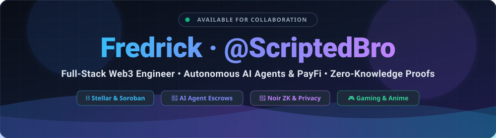
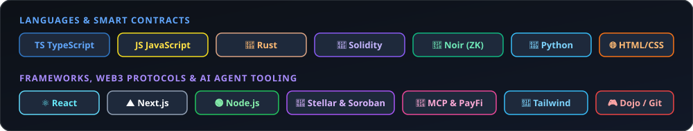
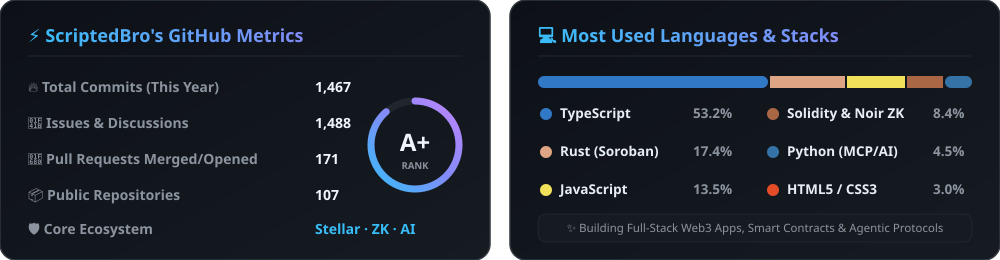

<div align="center">

  <!-- Self-Hosted Animated SVG Header (Zero External Downtime) -->
  

  <br /><br />

  <!-- Quick Links -->
  <p align="center">
    <kbd>📧 <a href="mailto:fredrickloveday@gmail.com"><b>fredrickloveday@gmail.com</b></a></kbd>
    &nbsp;&nbsp;•&nbsp;&nbsp;
    <kbd>📦 <a href="https://github.com/ScriptedBro?tab=repositories"><b>107+ Repositories</b></a></kbd>
    &nbsp;&nbsp;•&nbsp;&nbsp;
    <kbd>⚡ <b>Web3 · AI Agents · ZK Proofs</b></kbd>
  </p>

</div>

---

### ⚡ About Me

```yaml
name: Fredrick Loveday (@ScriptedBro)
role: Full-Stack Developer & Web3 / AI Engineer
focus_areas:
  - 🌐 Modern Web Architecture: React, Next.js, TypeScript & Accessible UI/UX (WCAG)
  - ⛓️ Decentralized Protocols: Stellar / Soroban, Solidity, Cairo / Dojo & Creditcoin
  - 🤖 Autonomous AI Agents & PayFi: Agentic Escrows, MCP Servers & x402 Payments
  - 🔐 Privacy & Zero-Knowledge: Noir, UltraHonk ZK Proofs & On-Chain Verification
interests:
  - 🎮 Gaming & On-Chain Game Dev
  - 🎌 Anime
  - 🚀 Open-Source Collaboration
contact: "fredrickloveday@gmail.com"
```

---

### 🛠️ Tech Stack & Arsenal

<div align="center">
  
</div>

---

### 🚀 Featured Projects

<table width="100%">
  <tr>
    <td width="50%" valign="top">
      <h3 align="center">🤖 <a href="https://github.com/ScriptedBro/SynapsePay">SynapsePay</a></h3>
      <p align="center">
        <b>Autonomous Agent-to-Agent Escrow &amp; SLA Arbitration Protocol</b><br />
        Powered by PayPal &amp; TypeScript — enabling trustless machine-to-machine commerce, automated SLA verification, and dispute resolution.
      </p>
      <p align="center">
        <code>TypeScript</code> &nbsp; <code>AI Agents</code> &nbsp; <code>PayFi</code> &nbsp; <code>Escrow</code>
      </p>
    </td>
    <td width="50%" valign="top">
      <h3 align="center">🛡️ <a href="https://github.com/ScriptedBro/stellar-whisper">Stellar Whisper</a></h3>
      <p align="center">
        <b>Compliance-First Shielded Wallet &amp; Remittance App</b><br />
        Private USDC transfers on Stellar powered by Zero-Knowledge proofs (Noir / UltraHonk) with on-chain Soroban verification.
      </p>
      <p align="center">
        <code>Stellar</code> &nbsp; <code>Soroban</code> &nbsp; <code>Noir ZK</code> &nbsp; <code>TypeScript</code>
      </p>
    </td>
  </tr>
  <tr>
    <td width="50%" valign="top">
      <h3 align="center">🛒 <a href="https://github.com/ScriptedBro/Delego">Delego</a></h3>
      <p align="center">
        <b>Agentic AI Commerce Platform on Stellar</b><br />
        Delegate shopping and payment tasks to autonomous AI agents while retaining granular approval, escrow, and spending controls via Soroban.
      </p>
      <p align="center">
        <code>Soroban</code> &nbsp; <code>AI Commerce</code> &nbsp; <code>Stellar</code> &nbsp; <code>TypeScript</code>
      </p>
    </td>
    <td width="50%" valign="top">
      <h3 align="center">🔐 <a href="https://github.com/ScriptedBro/PassportZero">PassportZero</a></h3>
      <p align="center">
        <b>Zero-Knowledge Economic Passport</b><br />
        Enables users across Africa to prove trust, financial reliability, and on-chain contribution without banks, IDs, or exposing sensitive personal data.
      </p>
      <p align="center">
        <code>Solidity</code> &nbsp; <code>Zero-Knowledge</code> &nbsp; <code>Decentralized ID</code>
      </p>
    </td>
  </tr>
  <tr>
    <td width="50%" valign="top">
      <h3 align="center">🤝 <a href="https://github.com/ScriptedBro/Clinch">Clinch</a></h3>
      <p align="center">
        <b>Self-Executing Cross-Chain Escrow Protocol</b><br />
        Trust-minimized escrow infrastructure powered by Creditcoin &amp; Attestcoin for automated settlement and attestation verification.
      </p>
      <p align="center">
        <code>Creditcoin</code> &nbsp; <code>Smart Contracts</code> &nbsp; <code>TypeScript</code>
      </p>
    </td>
    <td width="50%" valign="top">
      <h3 align="center">💣 <a href="https://github.com/ScriptedBro/BomberMan">BomberMan (Dojo)</a> &amp; <a href="https://github.com/ScriptedBro/AccessCart">AccessCart</a></h3>
      <p align="center">
        <b>On-Chain Gaming &amp; Accessible Web Experiences</b><br />
        From classic arcade games rebuilt for Dojo on-chain gaming to WCAG-audited, keyboard-first React applications like AccessCart &amp; StayWell.
      </p>
      <p align="center">
        <code>Dojo Engine</code> &nbsp; <code>React</code> &nbsp; <code>TypeScript</code> &nbsp; <code>WCAG a11y</code>
      </p>
    </td>
  </tr>
</table>

---

### 📊 GitHub Analytics & Language Breakdown

<div align="center">
  
</div>

---

### 🤝 Let's Connect & Build Together

<div align="center">
  <p>Always open to collaborating on innovative <b>Web Development</b>, <b>Web3 / Stellar / ZK</b>, and <b>Autonomous AI Agent</b> projects!</p>
  <p>
    <kbd>📬 <a href="mailto:fredrickloveday@gmail.com"><b>Send Me an Email</b></a></kbd>
    &nbsp;&nbsp;&nbsp;
    <kbd>🐙 <a href="https://github.com/ScriptedBro"><b>Follow @ScriptedBro</b></a></kbd>
  </p>
  <br />
  
</div>
